# Current architecture (v0.7.65b732, as implemented)

This document describes the code **as it is**. Smells are tagged with backlog IDs from
`../quality/backlog/`. The target design is in `target-architecture.md`.

## Pipeline

```mermaid
flowchart TD
  A[main.py::main] --> B[DataArgs<br/>helpers/base/data_args.py<br/>argparse in __init__]
  B --> D[GeneralContext<br/>controllers/context/general_context.py<br/>one LanguageManager built from data_args.data_file.locale,<br/>injected into ApplicationConfig/FileSystemUtils; LoggerManager only<br/>opens a file handler when --debug]
  D --> E[SpreadsheetProcessor<br/>controllers/spreadsheet_processor.py<br/>constructor only stores dependencies ARC-001;<br/>main.py calls processor.run() explicitly]
  E --> E1[_prepare_statement: one empty report per NamesEnum]
  E1 --> E2[_read_data: DataLoaderFacade.load]
  E2 --> E3[_configure: instantiate 8 Sp* models, call model.run() explicitly on each]
  E3 --> E4[_build_pipeline: DataModelContext + rules engine, every validator ported to a RuleRegistry ARC-008/ARC-017]
  E4 --> E5[_report: FileReportGenerator.build_report]
  E5 --> F[HTML + PDF in output folder<br/>JSON fragment on stdout]
  A --> G[GeneralContext.finalize<br/>closes/detaches every file-logger handler;<br/>prints the log path only when --debug]
```

`Bootstrap` (`middleware/bootstrap.py`, and the `middleware` package with it) is deleted (BUG-004):
locale is threaded as an explicit `--locale` value from `DataArgs` into `GeneralContext`, with no
`.config/store.locale` persistence step between them.

### Execution order inside `SpreadsheetProcessor`

| Step | Method | What happens | Report bucket |
|---|---|---|---|
| 0 | `_prepare_statement` | `ValidationReport.add_by_name` for every `NamesEnum` title (fixed order in the report) | all |
| 1 | `_read_data` | `DataLoaderFacade(input_folder).load()` → `raw_data_map: dict[str, LoadedSheet]` + load errors; extracts `scenarios` from `cenarios.simbolo`; builds `model_configurations` (`scenario_exists_file`, `scenario_read_success`, `scenarios`, `legend_exists_file`, `legend_read_success`) | FS |
| 2 | `_configure` | For each class in `target_model_classes` (`SpDescription, SpComposition, SpValue, SpTemporalReference, SpProportionality, SpScenario, SpLegend, SpDictionary`) instantiate the model (constructor only stores dependencies, ARC-001 Phase 3 Port 8), then call `model_instance.run()` explicitly (`initialize()` + `pre_processing()`/`expected_structure_columns()`/`data_cleaning()`), then copy `structural_errors/warnings` → FS and `data_cleaning_errors/warnings` → FC | FS, FC |
| 3 | `_build_pipeline` | `DataModelContext(context, initialized_models)`; builds one shared `RuleContext` (`_build_rule_context`, which also computes `composition_facts` once via `compute_composition_facts` — BUG-019, and constructs the `SpellChecker` backend once, injected as `ctx.options["spell_backend"]`), then calls `_run_rule_registries([STRUCTURE_REGISTRY], ctx)` (ARC-017 Phase 3b), then `_run_rule_registries([SPELL_REGISTRY], ctx)` + `self._spell_backend.clean_files_generated()` (ARC-017 Phase 3 Port 8, replacing the deleted `SpellCheckerValidator` — the last validator ported, `data_validate/validators/` is now deleted entirely, ARC-008), then `_run_rule_registries([DESCRIPTION_REGISTRY, COMPOSITION_REGISTRY], ctx)` (ARC-017 Phase 3 Port 2/3), then `_run_rule_registries([TEMPORAL_REGISTRY], ctx)` (ARC-017 Phase 3 Port 4), then `_run_rule_registries([PROPORTIONALITY_REGISTRY], ctx)` (ARC-017 Phase 3 Port 7), then `_run_rule_registries([VALUE_REGISTRY], ctx)` (ARC-017 Phase 3 Port 5), then `_run_rule_registries([SCENARIO_REGISTRY], ctx)` (ARC-017 Phase 3 Port 4), then `_run_rule_registries([LEGEND_REGISTRY], ctx)` (ARC-017 Phase 3 Port 6) — every `_run_rule_registries` call builds `Engine(registry).run(ctx)` and renders outcomes via `rules.legacy_adapter.extend_report_from_outcomes`; no constructor-runs-pipeline involved anywhere in this step | per `NamesEnum` |
| 4 | `_report` | debug dump to logger; `FileReportGenerator(context).build_report(validation_reports)` | — |

`SpreadsheetProcessor.run()` itself is now called explicitly by `main.py::main` (ARC-001 Phase 3
Port 8) — construction only stores dependencies; `run()` prints the welcome banner via the logger,
starts the timer, runs the five steps above, then prints the total-execution-time line (unchanged
behaviour, just moved out of `__init__`).

## Components

### Entry and context

| Component | File | Responsibility | Smells |
|---|---|---|---|
| `main()` | `data_validate/main.py` | Wires `DataArgs → GeneralContext → SpreadsheetProcessor → finalize`; prints welcome banner at import | ARC-012, SEC-008 |
| `DataArgs`, `DataFile`, `DataAction`, `DataReport` | `helpers/base/data_args.py` | argparse definition and validation; `allow_abbrev=True` makes `--i/--o/--l` work | ARC-001, ARC-011, BUG-009 |
| `GeneralContext` | `controllers/context/general_context.py` | Holds `data_args`, `language_manager` (built once from `data_args.data_file.locale`, BUG-004/BUG-023), `config`, `file_system_utils` (both injected with the same `language_manager`), `logger_manager`, `logger`; disables logger unless `--debug`; opens a file handler only in debug mode, under `<output_folder>/logs`; `finalize()` closes and detaches every file-logger handler | ARC-006 |
| `DataModelContext` | `controllers/context/data_model_context.py` | Holds initialized models; `get_instance_of(cls)` linear `isinstance` scan | ARC-006 |
| `ApplicationConfig` | `config/application_config.py` | Constants (`TITLE_OVER_N_CHARS=40`, `SIMPLE_DESCRIPTIONS_OVER_N_CHARS=150`, `REPORT_LIMIT_N_MESSAGES=20`, `VALUE_DATA_UNAVAILABLE="DI"`, `LABEL_DATA_UNAVAILABLE="Dado indisponível"`, `PRECISION_DECIMAL_PLACE_TRUNCATE=3`, `DATE_NOW`, `CURRENT_YEAR`), fallback HTML template, `get_verify_names()` | BUG-011, PERF-004 |
| `NamesEnum` | `config/names_enum.py` | 34 verification keys → i18n keys `verification_name_*` | — |
| `SpreadsheetInfo` / `SHEET` | `config/spreadsheet_info.py` | Sheet stems, `.csv/.xlsx`, `EXPECTED_FILES`, `OPTIONAL_FILES` | ARC-003 |
| `MetadataInfo` / `METADATA` | `config/metadata_info.py` | Version string from installed metadata + hand-maintained `serial` | BUG-017, TOOL-005 |

### Loading

| Component | File | Responsibility | Smells |
|---|---|---|---|
| `DataLoaderFacade.load()` (method) | `helpers/tools/data_loader/api/facade.py` | Scan folder, pick reader + header strategy per stem (from `SHEET_SPECS`), read into `LoadedSheet`, collect read errors, fill missing sheets with empty models, return `LoadResult(models, errors)` | ARC-009 (done) |
| `DataLoaderFacade.load_all` (property) | same file | Deprecated one-release shim: warns `DeprecationWarning`, returns `(result.models, result.errors)` | ARC-009 |
| `LoadResult` | same file | Frozen dataclass: `models: dict[str, LoadedSheet]`, `errors: list[str]` | — |
| `LoadedSheet` | same file | `path`, `raw_data`, `is_read_successful`, `does_file_exist`, `header_type`; renamed from `DataLoaderModel` in Phase 5 (ARC-009/ARC-013), which is kept as a plain class alias for one release | ARC-009 (done), ARC-013 (done) |
| `FileScanner.scan` | `.../engine/scanner.py` | Finds stems declared in `SHEET_SPECS`/`ALLOWED_EXTENSIONS`; CSV wins over XLSX (documented policy), returns `(found, ignored, missing)` | — |
| `ReaderFactory` | `.../engine/factory.py` | `.csv → CSVReader(sep=...)`, `.xlsx → ExcelReader` | — |
| `CSVReader`, `ExcelReader` | `.../readers/*.py` | `read_csv(sep from constructor param, dtype=str)` with MultiIndex forward-fill; `read_excel(engine="calamine", dtype=str)` | SEC-003 |
| `SingleHeaderStrategy`, `DoubleHeaderStrategy` | `.../strategies/header.py` | `header=0` or `[0, 1]`, selected from `SheetSpec.header` | — |

### Models (`data_validate/models/`)

All inherit `SpModelABC` (`sp_model_abc.py`): `__init__` only stores context/data model/kwargs and
sets `self.frame` (this instance's own working frame, aliasing `data_model.raw_data` until a
subclass reassigns it via a non-mutating op) and `self.cleaned` (this instance's own
cleaned-column store) — no I/O, no validation work (ARC-001 Phase 3 Port 8). Each subclass's
`run()` (called explicitly by its caller, e.g. `SpreadsheetProcessor._configure`, never
automatically from `__init__`) calls `self.initialize()` first (dedupe scenarios, empty-file
error, `|` check, unnamed-column check — this used to run from `SpModelABC.__init__` itself), then
`pre_processing() → expected_structure_columns() → data_cleaning() [→ post_processing()]` when the
file exists. Results go to `structural_errors/warnings` and `data_cleaning_errors/warnings`. Column
*definitions* remain nested classes of `pd.Series` (`RequiredColumn`, `OptionalColumn`,
`DynamicColumn`, `PluralColumn`) — pure name/dtype placeholders, never reassigned (BUG-002,
fixed); cleaned *data* lives on the instance (`self.cleaned[column_name]`, read via
`cleaned_column(name)`).

| Model | Sheet | Specific behaviour | Smells |
|---|---|---|---|
| `SpDescription` | `descricao` | Dynamic `cenario`/`legenda` columns depend on scenario/legend files; drops/injects `relacao=1`, `unidade=""` on `self.frame` (BUG-003, fixed); cleans `codigo`, `nivel` (min 1), `cenario` (min −1), `legenda` (min 1, empty allowed) into `self.cleaned` (BUG-002, fixed) | — |
| `SpComposition` | `composicao` | Cleans `codigo_pai`, `codigo_filho` (min 1) into `self.cleaned` (BUG-002, fixed) | — |
| `SpValue` | `valores` | Columns must match `^\d+-\d{4}(-SCENARIO)?$`; `id` required | BUG-013 |
| `SpTemporalReference` | `referencia_temporal` | Without scenarios the sheet must have exactly one row; cleans `simbolo` (min 0) into `self.cleaned` (BUG-002, fixed) | — |
| `SpProportionality` | `proporcionalidades` | Double header; level-0 and level-1 pattern checks; on structural error empties `self.frame` and sets `self.header_layout_invalid = True` (BUG-003, fixed — `data_loader_model.raw_data`/`.header_type` are no longer touched) | ARC-009 |
| `SpScenario` | `cenarios` | Duplicate `simbolo` detection | — |
| `SpLegend` | `legenda` | `data_cleaning` runs `LegendProcessing` per legend code (sequence, dtypes, labels, colour, decimals, min/max continuity, order) only if `is_sanity_check_passed` | — |
| `SpDictionary` | `dicionario` | Reads first column as `words_to_ignore` | — |

### Validators — `data_validate/validators/` is deleted (ARC-008, ARC-017 Phase 3 Port 8)

Every validator that used to live under `data_validate/validators/` (`BaseValidator` and its
eight `Sp*Validator` subclasses) is now deleted; the package itself no longer exists. Each
validator's checks were ported, one Phase 3 slice at a time, onto the `rules` engine
(`data_validate/rules/`) as pure `check_*` functions registered in a `RuleRegistry` and run
through `SpreadsheetProcessor._run_rule_registries([REGISTRY], ctx) → Engine(REGISTRY).run(ctx) →
rules.legacy_adapter.extend_report_from_outcomes`; `ARC-008`'s ad hoc `set_not_executed`
placeholder and triplicated `column_exists*` helpers are gone with `base_validator.py` — the
engine's `RuleSpec.requires`/`depends_on` (checked once per rule, `Engine._unmet_prerequisite`)
now do what that placeholder wanted.

| Former validator | Rules (method → NamesEnum) | Smells |
|---|---|---|
| ~~`FileStructureValidator`~~ | **deleted (ARC-017 Phase 3b)** — its four checks (empty dir, unexpected files/folders, missing required, csv/xlsx conflict) are now `rules/structure.py`'s six `STRUCT-001`…`STRUCT-006` pure functions, run by `SpreadsheetProcessor._run_rule_registries([STRUCTURE_REGISTRY], ctx) → FS` | BUG-026 (resolved by the port: no instance state left to duplicate) |
| ~~`SpellCheckerValidator`~~ | **deleted (ARC-017 Phase 3 Port 8, the last validator ported)** — its pipeline (`_prepare_statement` dictionary/backend errors, `validate_spellchecker(SpDescription/SpTemporalReference/SpScenario)`) is now `rules/spell.py`'s `SPELL-001`…`SPELL-005` pure functions, backed by the same `SpellChecker` (pyenchant, constructed once by `SpreadsheetProcessor._build_rule_context` and injected as `ctx.options["spell_backend"]`), run by `SpreadsheetProcessor._run_rule_registries([SPELL_REGISTRY], ctx) → SPELL` | BUG-022, BUG-023, BUG-027 (preserved, not reopened: dictionary errors still surface regardless of `--no-spellchecker`) |
| ~~`SpDescriptionValidator`~~ | **deleted (ARC-017 Phase 3 Port 2)** — its nine checks are now `rules/description.py`'s ten `DESC-001`…`DESC-010` pure functions (`HTML_DESC, SC, CO_UN, INP, IL, MAND_PUNC_DESC, EF, LB_DESC, SIMP_DESC_N, TITLES_N`), run by `SpreadsheetProcessor._run_rule_registries([DESCRIPTION_REGISTRY], ctx)` | PERF-001 (resolved by the port: no `iterrows()` left in this validator) |
| ~~`SpCompositionGraphValidator`~~ / ~~`SpCompositionTreeValidator`~~ | **deleted (ARC-017 Phase 3 Port 3)** — their nine checks are now `rules/composition.py`'s nine `COMP-001`…`COMP-009` pure functions (`IR, IR, IR, UT, LEAF_NO_DATA, LEAF_NO_DATA, TH, TH, CHILD_LVL`), run by `SpreadsheetProcessor._run_rule_registries([DESCRIPTION_REGISTRY, COMPOSITION_REGISTRY], ctx)` | BUG-019 (resolved: `compute_composition_facts` computes the graph/tree/relation facts once, injected via `ctx.options["composition_facts"]`), BUG-024 (resolved: the `compostion_` filename typo is gone), PERF-001 (resolved: no `iterrows()` left in this validator) |
| ~~`SpTemporalReferenceValidator`~~ | **deleted (ARC-017 Phase 3 Port 4)** — its three checks are now `rules/temporal_reference.py`'s `TEMP-001`…`TEMP-003` pure functions (`MAND_PUNC_TEMP, YEARS_TEMP, UVR_TEMP`), run by `SpreadsheetProcessor._run_rule_registries([TEMPORAL_REGISTRY], ctx)` | BUG-007 (preserved, not reopened: the current year now comes from `ctx.clock().year`) |
| ~~`SpProportionalityValidator`~~ | **deleted (ARC-017 Phase 3 Port 7)** — its five checks are now `rules/proportionality.py`'s eight `PROP-003`…`PROP-010` pure functions (`IR, REP_IND_PROP, IND_VAL_PROP, IR_PROP, SUM_PROP` ×4 — PROP-007…010 share one `RuleSpec`, see the module's own docstring), run by `SpreadsheetProcessor._run_rule_registries([PROPORTIONALITY_REGISTRY], ctx)` | BUG-006 (preserved, not reopened), BUG-014 (preserved, not reopened), PERF-001 (resolved: no `iterrows()` left in this validator) |
| ~~`SpValueValidator`~~ | **deleted (ARC-017 Phase 3 Port 5)** — its three checks are now `rules/value.py`'s four `VAL-002`…`VAL-005` pure functions (`IR, VAL_COMB, UNAV_INV, UNAV_INV`), run by `SpreadsheetProcessor._run_rule_registries([VALUE_REGISTRY], ctx)` | BUG-001 (resolved by the port: no shared mutable state, pinned by `tests/unit/rules/test_value.py::TestIdempotency`), BUG-014 (preserved, not reopened) |
| ~~`SpScenarioValidator`~~ | **deleted (ARC-017 Phase 3 Port 4)** — its two checks are now `rules/scenario.py`'s `SCEN-003`…`SCEN-004` pure functions (`MAND_PUNC_SCEN, UVR_SCEN`), run by `SpreadsheetProcessor._run_rule_registries([SCENARIO_REGISTRY], ctx)` | — |
| ~~`SpLegendValidator`~~ | **deleted (ARC-017 Phase 3 Port 6)** — its two checks are now `rules/legend.py`'s four `LEG-012`…`LEG-015` pure functions (`LEG_REL, LEG_REL, LEG_REL, LEG_RANGE`), run by `SpreadsheetProcessor._run_rule_registries([LEGEND_REGISTRY], ctx)` | PERF-001 (resolved by the port: no per-cell loop left in this validator) |

Helpers used by rules live in `helpers/common/` (`validation/*Processing`,
`processing/*Processing`, `formatting/*Processing`, `generation/CombinationsProcessing`) as
static-method namespaces (ARC-007), and — for spelling — `helpers/tools/spellchecker/**`
(`SpellChecker`, `SpellCheckerController`, `DataFrameProcessor`, `DictionaryManager`,
`TextProcessor`), unchanged in shape but extended with a structured
(`SpellingFinding`-returning) surface (`check_spelling_text_structured`,
`find_quality_findings`, `build_quality_findings`) alongside the original string-returning one,
kept for backward compatibility.

### Reporting

| Component | File | Responsibility | Smells |
|---|---|---|---|
| `ReportItem`, `ValidationReport` | `controllers/report/validation_report.py` | Ordered dict of `test_name → (errors, warnings, was_executed)`; `flatten(n)` truncates and adds the "omitted" message; raises `ValueError` instead of dereferencing a `None` context when truncation is needed (BUG-005, fixed); `ReportItem` is the BUG-020 rename of the former `TestReportItem` (kept as a deprecated alias, `__test__ = False`) | none |
| `FileReportGenerator` | `controllers/report/file_report_generator.py` | Loads `static/report/report_template.html` (regex-validated against the fallback), builds HTML strings for errors/warnings, renders Jinja2 **without autoescape**, writes `<input-folder-name>_report.html`, converts to PDF with `pdfkit`, prints `<{json}>` built with `json.dumps(..., ensure_ascii=False)` (BUG-010, fixed) | SEC-001, SEC-002 |

### Cross-cutting

| Concern | Implementation | Smells |
|---|---|---|
| i18n | One `LanguageManager` per run, built by `GeneralContext` from the explicit `--locale` value (no file I/O to resolve it, BUG-004 fixed), loads `static/locales/<lang>/messages.json`; `text(key, **kwargs)`; shared by `ApplicationConfig`/`FileSystemUtils`; used by only a few components — everything else is hard-coded pt-BR | ARC-005, BUG-016 |
| Logging | `LoggerManager` (console + file, colour formatter); a file handler is only created in debug mode, under `<output_folder>/logs`; `finalize()` closes every handler (BUG-021 fixed) | — |
| Spell-check | `SpellChecker → DictionaryManager (enchant Broker, ENCHANT_CONFIG_DIR = static/dictionaries)`, `SpellCheckerController`, `TextProcessor`, `DataFrameProcessor` | ARC-015, BUG-022 |
| Errors as data | `list[str]` of pre-formatted messages everywhere | ARC-004 |
| Rules engine | `data_validate/rules/` (`RuleContext`, `RuleRegistry`, `Engine`) is live and wired for eight validators so far: `SpreadsheetProcessor._run_rule_registries` runs `STRUCTURE_REGISTRY`, `DESCRIPTION_REGISTRY`, `COMPOSITION_REGISTRY`, `TEMPORAL_REGISTRY`, `VALUE_REGISTRY`, `SCENARIO_REGISTRY`, and `LEGEND_REGISTRY` (one shared `RuleContext`, built once by `_build_rule_context`) and renders each into `ValidationReport` via `rules.legacy_adapter.extend_report_from_outcomes` — see `module-map.md`'s `rules/` section for the full table | ARC-017 (in progress, eight of ten validators ported) |

## Data ownership and mutation (BUG-002/BUG-003 fixed)

```mermaid
flowchart LR
  F[(files)] --> L[LoadedSheet.raw_data<br/>one DataFrame per sheet, never mutated after load]
  L --> FR[Sp*.frame<br/>per-instance working copy]
  FR -->|SpDescription.pre_processing drops/injects via .drop/.assign, reassigning self.frame| FR
  FR -->|SpProportionality.post_processing empties self.frame,<br/>sets self.header_layout_invalid| FR
  FR -->|copied per validator| V1[BaseValidator._dataframe]
  FR --> V2[validator.model_dataframes references]
  C[Sp*.cleaned dict<br/>per-instance] -->|populated by data_cleaning| C
  C --> CC[model.cleaned_column&#40;name&#41; accessor]
  M[Sp* RequiredColumn/DynamicColumn Series<br/>pure name/dtype placeholders] -.never reassigned.-> M
```



Every model owns its own `self.frame` (working copy, starts out aliasing `raw_data`) and
`self.cleaned` (dict of cleaned `pd.Series` by column name); `data_loader_model.raw_data` is
never written after load, and the `RequiredColumn`/`OptionalColumn`/`DynamicColumn` nested
classes stay pure column *definitions* — no `setattr`/reassignment on them. Rules read a model's
working data through `ctx.sheet(name)`/`RuleContext.sheets` and its cleaned columns through
`RuleContext.cleaned`, never through a class attribute. This removes the cross-instance/cross-run
state leak (BUG-002) and the shared-object mutation (BUG-003) that used to make two models built
from different input in the same process interfere with each other; ARC-001 is done (models,
`SpreadsheetProcessor`, and every deleted validator no longer do work in `__init__` — `DataArgs`'s
argparse-in-`__init__` is the one accepted exception, a CLI-boundary object, ADR-0005) — the
remaining obstacle to a fully declarative pipeline is ARC-007 (models still both validate and
clean, "Processing" classes are still procedural namespaces).

## Files and folders written at runtime

| Path | When | Smell |
|---|---|---|
| `<output_folder>/logs/data_validate_<ts>.log` | only with `--debug`; kept on disk, handlers closed by `finalize()` | — |
| `<output>/<input-name>_report.html`, `.pdf` | every run | — |
| `<package>/static/dictionaries/<lang>.dic|.exc` | spell-check with user words | BUG-022 |

`./.config/store.locale` and `data/output/logs/` created unconditionally relative to the CWD (BUG-004,
BUG-021) are both removed as of this slice — see `.specs/future/deprecations.md`.

Last synced with code: ARC-017 Phase 3 Port 8 (SPELL-001…005 ported to `rules/spell.py`; legacy
`SpellCheckerValidator` deleted; `data_validate/validators/` deleted entirely, closing ARC-008;
every model's `run()` and `SpreadsheetProcessor.run()` are called explicitly by their caller
instead of automatically from `__init__`, closing ARC-001 except for `DataArgs`'s
argparse-in-`__init__`)
