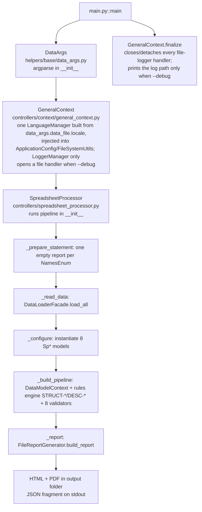

# Current architecture (v0.7.65b732, as implemented)

This document describes the code **as it is**. Smells are tagged with backlog IDs from
`../quality/backlog/`. The target design is in `target-architecture.md`.

## Pipeline

`Bootstrap` (`middleware/bootstrap.py`, and the `middleware` package with it) is deleted (BUG-004):
locale is threaded as an explicit `--locale` value from `DataArgs` into `GeneralContext`, with no
`.config/store.locale` persistence step between them.

### Execution order inside `SpreadsheetProcessor`

| Step | Method | What happens | Report bucket |
|---|---|---|---|
| 0 | `_prepare_statement` | `ValidationReport.add_by_name` for every `NamesEnum` title (fixed order in the report) | all |
| 1 | `_read_data` | `DataLoaderFacade(input_folder).load_all` → `raw_data_map: dict[str, DataLoaderModel]` + load errors; extracts `scenarios` from `cenarios.simbolo`; builds `model_configurations` (`scenario_exists_file`, `scenario_read_success`, `scenarios`, `legend_exists_file`, `legend_read_success`) | FS |
| 2 | `_configure` | For each class in `target_model_classes` (`SpDescription, SpComposition, SpValue, SpTemporalReference, SpProportionality, SpScenario, SpLegend, SpDictionary`) instantiate the model (which runs `initialize()` + `run()` in `__init__`), then copy `structural_errors/warnings` → FS and `data_cleaning_errors/warnings` → FC | FS, FC |
| 3 | `_build_pipeline` | `DataModelContext(context, initialized_models)`; builds one shared `RuleContext` (`_build_rule_context`, which also computes `composition_facts` once via `compute_composition_facts` — BUG-019), then calls `_run_rule_registries([STRUCTURE_REGISTRY], ctx)` (ARC-017 Phase 3b) where `_run_structure_rules` used to run standalone, then `SpellCheckerValidator`, then `_run_rule_registries([DESCRIPTION_REGISTRY, COMPOSITION_REGISTRY], ctx)` (ARC-017 Phase 3 Port 2/3, replacing the deleted `SpDescriptionValidator`/`SpCompositionGraphValidator`/`SpCompositionTreeValidator`) — each `_run_rule_registries` call builds `Engine(registry).run(ctx)` and renders outcomes via `rules.legacy_adapter.extend_report_from_outcomes`, no constructor-runs-pipeline involved — then instantiates the remaining validators in this order (each still runs in `__init__`): `SpTemporalReferenceValidator`, `SpProportionalityValidator`, `SpValueValidator`, `SpScenarioValidator`, `SpLegendValidator` | per `NamesEnum` |
| 4 | `_report` | debug dump to logger; `FileReportGenerator(context).build_report(validation_reports)` | — |

## Components

### Entry and context

| Component | File | Responsibility | Smells |
|---|---|---|---|
| `main()` | `data_validate/main.py` | Wires `DataArgs → GeneralContext → SpreadsheetProcessor → finalize`; prints welcome banner at import | ARC-012, SEC-008 |
| `DataArgs`, `DataFile`, `DataAction`, `DataReport` | `helpers/base/data_args.py` | argparse definition and validation; `allow_abbrev=True` makes `--i/--o/--l` work | ARC-001, ARC-011, BUG-009 |
| `GeneralContext` | `controllers/context/general_context.py` | Holds `data_args`, `language_manager` (built once from `data_args.data_file.locale`, BUG-004/BUG-023), `config`, `file_system_utils` (both injected with the same `language_manager`), `logger_manager`, `logger`; disables logger unless `--debug`; opens a file handler only in debug mode, under `<output_folder>/logs`; `finalize()` closes and detaches every file-logger handler | ARC-006 |
| `DataModelContext` | `controllers/context/data_model_context.py` | Holds initialized models; `get_instance_of(cls)` linear `isinstance` scan | ARC-006 |
| `ApplicationConfig` | `config/application_config.py` | Constants (`TITLE_OVER_N_CHARS=40`, `SIMPLE_DESCRIPTIONS_OVER_N_CHARS=150`, `REPORT_LIMIT_N_MESSAGES=20`, `VALUE_DATA_UNAVAILABLE="DI"`, `LABEL_DATA_UNAVAILABLE="Dado indisponível"`, `PRECISION_DECIMAL_PLACE_TRUNCATE=3`, `DATE_NOW`, `CURRENT_YEAR`), fallback HTML template, `get_verify_names()` | BUG-011, PERF-004 |
| `NamesEnum` | `config/names_enum.py` | 34 verification keys → i18n keys `verification_name_*` | — |
| `SpreadsheetInfo` / `SHEET` | `config/spreadsheet_info.py` | Sheet stems, `.csv/.xlsx`, `EXPECTED_FILES`, `OPTIONAL_FILES` | ARC-003 |
| `MetadataInfo` / `METADATA` | `config/metadata_info.py` | Version string from installed metadata + hand-maintained `serial` | BUG-017, TOOL-005 |

### Loading

| Component | File | Responsibility | Smells |
|---|---|---|---|
| `DataLoaderFacade.load()` (method) | `helpers/tools/data_loader/api/facade.py` | Scan folder, pick reader + header strategy per stem (from `SHEET_SPECS`), read into `DataLoaderModel`, collect read errors, fill missing sheets with empty models, return `LoadResult(models, errors)` | ARC-009 (in-progress) |
| `DataLoaderFacade.load_all` (property) | same file | Deprecated one-release shim: warns `DeprecationWarning`, returns `(result.models, result.errors)` | ARC-009 |
| `LoadResult` | same file | Frozen dataclass: `models: dict[str, DataLoaderModel]`, `errors: list[str]` | — |
| `DataLoaderModel` | same file | `path`, `raw_data`, `is_read_successful`, `does_file_exist`, `header_type` | ARC-009, ARC-013 (naming) |
| `FileScanner.scan` | `.../engine/scanner.py` | Finds stems declared in `SHEET_SPECS`/`ALLOWED_EXTENSIONS`; CSV wins over XLSX (documented policy), returns `(found, ignored, missing)` | — |
| `ReaderFactory` | `.../engine/factory.py` | `.csv → CSVReader(sep=...)`, `.xlsx → ExcelReader` | — |
| `CSVReader`, `ExcelReader` | `.../readers/*.py` | `read_csv(sep from constructor param, dtype=str)` with MultiIndex forward-fill; `read_excel(engine="calamine", dtype=str)` | SEC-003 |
| `SingleHeaderStrategy`, `DoubleHeaderStrategy` | `.../strategies/header.py` | `header=0` or `[0, 1]`, selected from `SheetSpec.header` | — |

### Models (`data_validate/models/`)

All inherit `SpModelABC` (`sp_model_abc.py`): `__init__` stores context/data model/kwargs, sets
`self.frame` (this instance's own working frame, aliasing `data_model.raw_data` until a subclass
reassigns it via a non-mutating op) and `self.cleaned` (this instance's own cleaned-column
store), then `initialize()` (dedupe scenarios, empty-file error, `|` check, unnamed-column
check) and the subclass `__init__` calls `run()` → `pre_processing() →
expected_structure_columns() → data_cleaning() [→ post_processing()]` when the file exists.
Results go to `structural_errors/warnings` and `data_cleaning_errors/warnings`. Column
*definitions* remain nested classes of `pd.Series` (`RequiredColumn`, `OptionalColumn`,
`DynamicColumn`, `PluralColumn`) — pure name/dtype placeholders, never reassigned (BUG-002,
fixed); cleaned *data* lives on the instance (`self.cleaned[column_name]`, read via
`cleaned_column(name)`).

| Model | Sheet | Specific behaviour | Smells |
|---|---|---|---|
| `SpDescription` | `descricao` | Dynamic `cenario`/`legenda` columns depend on scenario/legend files; drops/injects `relacao=1`, `unidade=""` on `self.frame` (BUG-003, fixed); cleans `codigo`, `nivel` (min 1), `cenario` (min −1), `legenda` (min 1, empty allowed) into `self.cleaned` (BUG-002, fixed) | — |
| `SpComposition` | `composicao` | Cleans `codigo_pai`, `codigo_filho` (min 1) into `self.cleaned` (BUG-002, fixed) | — |
| `SpValue` | `valores` | Columns must match `^\d+-\d{4}(-SCENARIO)?$`; `id` required | BUG-013 |
| `SpTemporalReference` | `referencia_temporal` | Without scenarios the sheet must have exactly one row; cleans `simbolo` (min 0) into `self.cleaned` (BUG-002, fixed) | — |
| `SpProportionality` | `proporcionalidades` | Double header; level-0 and level-1 pattern checks; on structural error empties `self.frame` and sets `self.header_layout_invalid = True` (BUG-003, fixed — `data_loader_model.raw_data`/`.header_type` are no longer touched) | ARC-009 |
| `SpScenario` | `cenarios` | Duplicate `simbolo` detection | — |
| `SpLegend` | `legenda` | `data_cleaning` runs `LegendProcessing` per legend code (sequence, dtypes, labels, colour, decimals, min/max continuity, order) only if `is_sanity_check_passed` | — |
| `SpDictionary` | `dicionario` | Reads first column as `words_to_ignore` | — |

### Validators (`data_validate/validators/`)

All inherit `BaseValidator` (`spreadsheets/base/base_validator.py`): resolve the model from
`DataModelContext`, copy its `frame` (`self._data_model.frame.copy()`, not
`data_loader_model.raw_data` — BUG-003, fixed), compute `TITLES_INFO = config.get_verify_names()`, then
`run()` builds a list of `(callable, NamesEnum.value)` and `build_reports()` executes each,
extending `ValidationReport` and catching **any** exception into an error message.

| Validator | Rules (method → NamesEnum) | Smells |
|---|---|---|
| ~~`FileStructureValidator`~~ | **deleted (ARC-017 Phase 3b)** — its four checks (empty dir, unexpected files/folders, missing required, csv/xlsx conflict) are now `rules/structure.py`'s six `STRUCT-001`…`STRUCT-006` pure functions, run by `SpreadsheetProcessor._run_rule_registries([STRUCTURE_REGISTRY], ctx) → FS` | BUG-026 (resolved by the port: no instance state left to duplicate) |
| `SpellCheckerValidator` | `validate_spellchecker(SpDescription/SpTemporalReference/SpScenario) → SPELL` via `SpellChecker` (pyenchant) | BUG-022, BUG-023 |
| ~~`SpDescriptionValidator`~~ | **deleted (ARC-017 Phase 3 Port 2)** — its nine checks are now `rules/description.py`'s ten `DESC-001`…`DESC-010` pure functions (`HTML_DESC, SC, CO_UN, INP, IL, MAND_PUNC_DESC, EF, LB_DESC, SIMP_DESC_N, TITLES_N`), run by `SpreadsheetProcessor._run_rule_registries([DESCRIPTION_REGISTRY], ctx)` | PERF-001 (resolved by the port: no `iterrows()` left in this validator) |
| ~~`SpCompositionGraphValidator`~~ / ~~`SpCompositionTreeValidator`~~ | **deleted (ARC-017 Phase 3 Port 3)** — their nine checks are now `rules/composition.py`'s nine `COMP-001`…`COMP-009` pure functions (`IR, IR, IR, UT, LEAF_NO_DATA, LEAF_NO_DATA, TH, TH, CHILD_LVL`), run by `SpreadsheetProcessor._run_rule_registries([DESCRIPTION_REGISTRY, COMPOSITION_REGISTRY], ctx)` | BUG-019 (resolved: `compute_composition_facts` computes the graph/tree/relation facts once, injected via `ctx.options["composition_facts"]`), BUG-024 (resolved: the `compostion_` filename typo is gone), PERF-001 (resolved: no `iterrows()` left in this validator) |
| `SpTemporalReferenceValidator` | `MAND_PUNC_TEMP, YEARS_TEMP, UVR_TEMP` | BUG-007 |
| `SpProportionalityValidator` | `IR, REP_IND_PROP, IND_VAL_PROP, IR_PROP, SUM_PROP` | BUG-006 |
| `SpValueValidator` | `IR, VAL_COMB, UNAV_INV` | BUG-001, BUG-014 |
| `SpScenarioValidator` | `MAND_PUNC_SCEN, UVR_SCEN` | — |
| `SpLegendValidator` | `LEG_REL, LEG_RANGE` | PERF-001 |

Helpers used by validators live in `helpers/common/` (`validation/*Processing`,
`processing/*Processing`, `formatting/*Processing`, `generation/CombinationsProcessing`) as
static-method namespaces (ARC-007).

### Reporting

| Component | File | Responsibility | Smells |
|---|---|---|---|
| `ReportItem`, `ValidationReport` | `controllers/report/validation_report.py` | Ordered dict of `test_name → (errors, warnings, was_executed)`; `flatten(n)` truncates and adds the "omitted" message; raises `ValueError` instead of dereferencing a `None` context when truncation is needed (BUG-005, fixed); `ReportItem` is the BUG-020 rename of the former `TestReportItem` (kept as a deprecated alias, `__test__ = False`) | none |
| `FileReportGenerator` | `controllers/report/file_report_generator.py` | Loads `static/report/report_template.html` (regex-validated against the fallback), builds HTML strings for errors/warnings, renders Jinja2 **without autoescape**, writes `<input-folder-name>_report.html`, converts to PDF with `pdfkit`, prints `<{json}>` built with `json.dumps(..., ensure_ascii=False)` (BUG-010, fixed) | SEC-001, SEC-002 |

### Cross-cutting

| Concern | Implementation | Smells |
|---|---|---|
| i18n | One `LanguageManager` per run, built by `GeneralContext` from the explicit `--locale` value (no file I/O to resolve it, BUG-004 fixed), loads `static/locales/<lang>/messages.json`; `text(key, **kwargs)`; shared by `ApplicationConfig`/`FileSystemUtils`; used by only a few components — everything else is hard-coded pt-BR | ARC-005, BUG-016 |
| Logging | `LoggerManager` (console + file, colour formatter); a file handler is only created in debug mode, under `<output_folder>/logs`; `finalize()` closes every handler (BUG-021 fixed) | — |
| Spell-check | `SpellChecker → DictionaryManager (enchant Broker, ENCHANT_CONFIG_DIR = static/dictionaries)`, `SpellCheckerController`, `TextProcessor`, `DataFrameProcessor` | ARC-015, BUG-022 |
| Errors as data | `list[str]` of pre-formatted messages everywhere | ARC-004 |
| Rules engine | `data_validate/rules/` (`RuleContext`, `RuleRegistry`, `Engine`) is live and wired for two validators so far: `SpreadsheetProcessor._run_rule_registries` runs `STRUCTURE_REGISTRY` and `DESCRIPTION_REGISTRY` (one shared `RuleContext`, built once by `_build_rule_context`) and renders each into `ValidationReport` via `rules.legacy_adapter.extend_report_from_outcomes` — see `module-map.md`'s `rules/` section for the full table | ARC-017 (in progress, two of ten validators ported) |

## Data ownership and mutation (BUG-002/BUG-003 fixed)

Every model owns its own `self.frame` (working copy, starts out aliasing `raw_data`) and
`self.cleaned` (dict of cleaned `pd.Series` by column name); `data_loader_model.raw_data` is
never written after load, and the `RequiredColumn`/`OptionalColumn`/`DynamicColumn` nested
classes stay pure column *definitions* — no `setattr`/reassignment on them. Validators read a
model's working data through `model.frame`/`BaseValidator._dataframe` and its cleaned columns
through `model.cleaned_column(name)`, never through a class attribute. This removes the
cross-instance/cross-run state leak (BUG-002) and the shared-object mutation (BUG-003) that used
to make two models/validators built from different input in the same process interfere with each
other; the remaining obstacle to testing and parallelism is ARC-001 (work still happens in
constructors) and ARC-007 (models still both validate and clean, "Processing" classes are still
procedural namespaces).

## Files and folders written at runtime

| Path | When | Smell |
|---|---|---|
| `<output_folder>/logs/data_validate_<ts>.log` | only with `--debug`; kept on disk, handlers closed by `finalize()` | — |
| `<output>/<input-name>_report.html`, `.pdf` | every run | — |
| `<package>/static/dictionaries/<lang>.dic|.exc` | spell-check with user words | BUG-022 |

`./.config/store.locale` and `data/output/logs/` created unconditionally relative to the CWD (BUG-004,
BUG-021) are both removed as of this slice — see `.specs/future/deprecations.md`.

Last synced with code: cf5ddaa
